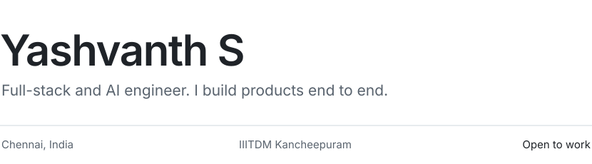

<picture>
  <source media="(prefers-color-scheme: dark)" srcset="assets/header-dark.svg">
  
</picture>

[yashvanth.com](https://yashvanth.com) &nbsp;·&nbsp; [Résumé](https://yashvanth.com/YashvanthS_Resume.pdf) &nbsp;·&nbsp; [LinkedIn](https://linkedin.com/in/yashvanths) &nbsp;·&nbsp; [LeetCode](https://leetcode.com/u/yashvanths/) &nbsp;·&nbsp; [yashvanthsankar@gmail.com](mailto:yashvanthsankar@gmail.com)

<br>

### Selected work

**[choco.video](https://github.com/YashvanthSankar/choco.video)** &nbsp;<sub>open source</sub><br>
Long videos in, captioned vertical clips out, entirely on your Mac.<br>
<sub>Rust · Tauri · Svelte · whisper.cpp · FFmpeg</sub>

**[Project Doppler](https://doppel-rw.vercel.app)** &nbsp;<sub>Random Walk</sub><br>
Turns a monitor into a window: head tracking re-renders a 3D scene from where you sit.<br>
<sub>TypeScript · Three.js · MediaPipe · FastAPI</sub>

**[GudTour](https://github.com/YashvanthSankar/bits-n-bytes)** &nbsp;<sub>2nd place, CS Week 2026</sub><br>
Multilingual disaster alerts for tourists in India, on Android and iOS.<br>
<sub>Expo · React Native · Convex</sub>

**[SuperFinz](https://github.com/YashvanthSankar/superfinz-gig)** &nbsp;<sub>1st place, Innovation Unbound '26</sub><br>
An income firewall for gig workers: what is safe to spend until the next payout.<br>
<sub>Next.js · Expo · Convex · OpenAI</sub>

**[Sagar Prahari](https://play.google.com/store/apps/details?id=com.swachhsagar.release)** &nbsp;<sub>Govt. of India</sub><br>
Official app of the Swachh Sagar, Surakshit Sagar 5.0 coastal campaign. 15 lakh pledges.<br>
<sub>Expo · Convex</sub>

<br>

### Experience

```
Jun–Aug 2026   AI Intern                Random Walk
Feb–Sep 2026   Founding Engineer        Promptli
Jan–Feb 2026   Software Dev Intern      Artly Creative Labs
Jan–Feb 2026   Lead Developer           E-Summit '26, IIITDM
2024–2029      B.Tech + M.Tech, CSE     IIITDM Kancheepuram · highest CGPA in cohort
```

<br>

### Recognition

1st place, Innovation Unbound at TechnoVIT '26, VIT Chennai &nbsp;<sub>150+ teams</sub><br>
2nd place, TravelTech track, CS Week 2026, IIITDM Kancheepuram<br>
2nd place, RetailTech/SaaS, VOID:V1 &nbsp;<sub>top 28 of 750+ teams</sub><br>
Ran the E-Summit '26 hackathon and ideathon &nbsp;<sub>600 participants, 50+ colleges</sub>

<br>

### Tools

<sub>LANGUAGES</sub><br>
TypeScript · Python · Rust · Swift · SQL · C++

<sub>BUILDING WITH</sub><br>
Next.js · React Native · Tauri · Convex · FastAPI · PostgreSQL · Redis

<sub>AI</sub><br>
LiveKit Agents · OpenAI Realtime · whisper.cpp · RAG

<sub>SHIPPING ON</sub><br>
Docker · AWS · Vercel · Cloudflare · Modal
